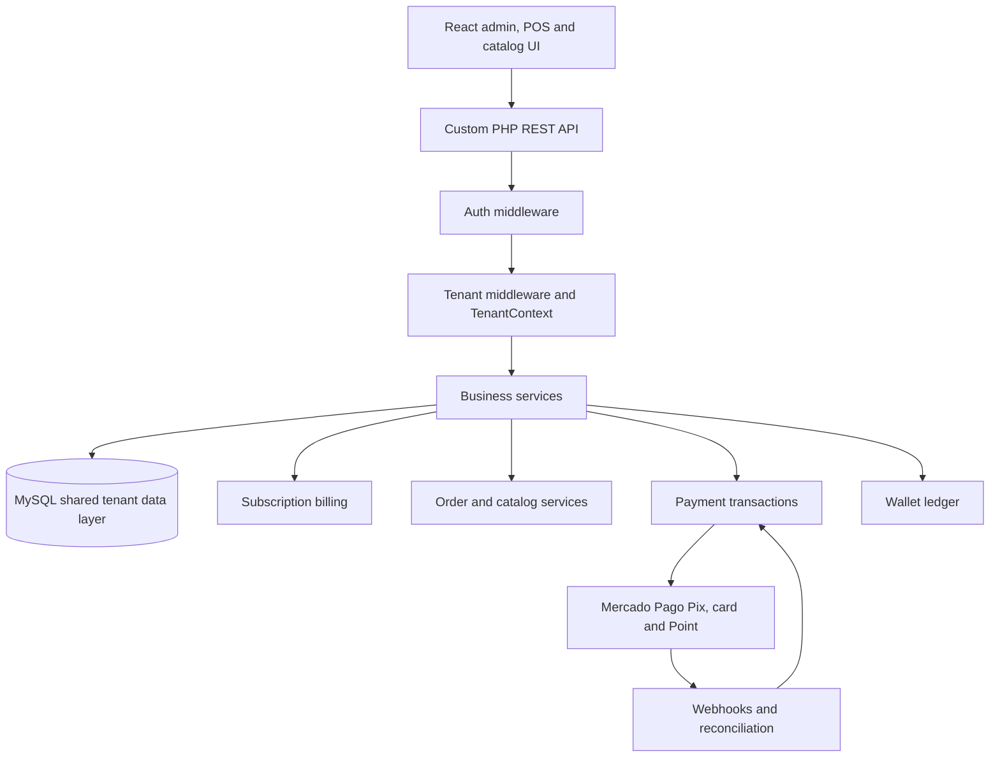

# Açaí Finance

### SaaS / Multi-Tenant / Marketplace / Payments

## Overview

Açaí Finance is a private commercial platform documented here as a safe public case study.

The product combines SaaS subscription management, tenant-isolated business data, catalog and order operations, POS flows, Mercado Pago payments, marketplace settlement and administrative tooling.

This repository does not contain proprietary source code, credentials, production URLs, customer data, database dumps or infrastructure secrets.

## Problem

Food and retail operations need more than a public catalog. They need product management, order control, sales tracking, cash operations, tenant-specific settings, payment processing and administrative visibility.

The platform also needs to onboard and operate multiple businesses while keeping each tenant isolated, enforcing subscription status and supporting marketplace payment flows without exposing financial consistency to frontend trust.

## Solution

The private codebase implements a custom PHP backend with a React frontend and a MySQL data layer organized around tenant context.

The system resolves tenants through request context, applies authentication and tenant checks at the middleware layer, exposes public catalog and authenticated business APIs, and integrates with Mercado Pago for Pix, card, POS and marketplace payment operations.

## Product Flow

## System Architecture

## Tech Stack

- Backend: PHP 8.2, custom PSR-style application structure, PDO, REST endpoints.
- Frontend: React 18, Vite, Tailwind CSS, Axios, Recharts, lucide-react.
- Database: MySQL with shared tables and tenant-scoped records.
- Payments: Mercado Pago Pix, card payments, Point/POS flows, OAuth connections, marketplace application fee.
- Infrastructure: Docker, Cloud Build, Cloud Run, Cloud SQL and Secret Manager references in private deployment documentation.

## Backend Engineering

The backend exposes APIs for authentication, tenant management, subscriptions, plans, users, products, categories, catalog settings, public orders, POS sessions, sales, payments, dashboard metrics and super-admin operations.

Tenant context is resolved before business handlers execute. The private code includes middleware that rejects cross-tenant access and disables unsafe query-based tenant switching in production.

Subscription state is part of the platform access path, allowing the application to control whether a tenant can operate the workspace and public catalog flows.

## Data / Database

The data model includes SaaS core tables for plans, tenants, subscriptions and subscription payments, plus operational tables for catalog, products, orders, payment transactions, wallet accounts, wallet ledger entries and withdrawal requests.

Financial movement is represented through payment transaction records and an append-only wallet ledger. The ledger design supports idempotent settlement and reversal entries for cases such as refunds and chargebacks.

## Integrations

- Mercado Pago payment creation for Pix and card flows.
- Mercado Pago OAuth connections for tenant-specific marketplace operations.
- Marketplace application fee calculation performed on the backend.
- Webhook processing with provider refetch and duplicate-event handling.
- POS/Point payment routes for in-person operations.

## Security

Security-relevant implementation details confirmed in the private codebase:

- Bearer token authentication stored server-side.
- Tenant authorization checked against authenticated user context.
- Production tenant resolution hardened against query-parameter spoofing.
- Mercado Pago webhook signature validation.
- Backend-owned payment amount and fee calculation.
- Card flows use provider tokenization rather than storing raw card data.
- Case study repository created without private Git history.

## Engineering Challenges

- Tenant isolation across public catalog, authenticated workspace, POS and super-admin paths.
- Preventing cross-tenant access when requests contain tenant headers, hosts or authenticated tokens.
- Keeping order status, payment status and wallet ledger entries consistent.
- Handling Mercado Pago webhooks idempotently.
- Supporting marketplace settlement while preserving backend ownership of fee calculation.
- Avoiding duplicate ledger effects during retries or repeated webhook delivery.
- Operating production deployment without exposing environment secrets.

## Testing & Reliability

The private project contains focused tests for tenant isolation, marketplace Pix split flow, Pix hardening, card settlement, recurring subscription safety, payment confirmation, POS payments, POS webhooks, catalog behavior and analytics flows.

The marketplace payment tests validate scenarios such as duplicate webhooks, forged or divergent webhook payloads, backend fee calculation, cross-tenant webhook protection and ledger effects.

## Infrastructure & Deployment

The private repository includes Docker and Google Cloud deployment material, including Cloud Build, Cloud Run, Cloud SQL and Secret Manager usage. Public documentation intentionally avoids exact project identifiers, domains, service names and operational secrets.

## Production

Production-oriented deployment and operations documentation exists in the private codebase. This public case study documents the architecture and engineering decisions without publishing production endpoints, credentials or internal runbooks.

## Screenshots

No screenshots are published in this repository. Existing assets may contain merchant, product, order or operational data and should only be used publicly after sanitization.

## My Role / What I Built

This case demonstrates full-stack product engineering across SaaS architecture, tenant isolation, backend APIs, React interfaces, payments, marketplace settlement, database modeling, tests and production deployment preparation.

## Key Engineering Decisions

- Use tenant context as a first-class backend concern instead of relying on frontend filtering.
- Keep payment amount and fee calculation on the server.
- Model financial settlement through transaction records and an append-only ledger.
- Treat webhooks as retriable and potentially duplicated.
- Keep the public case study separate from the commercial repository and its Git history.
