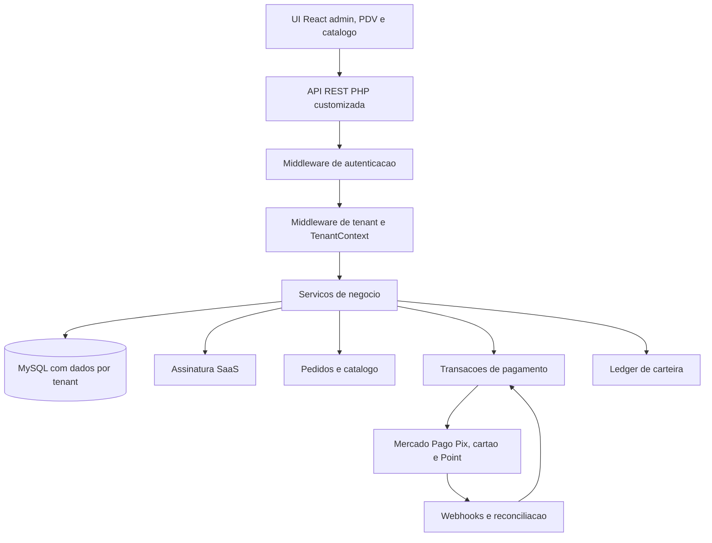

# Açaí Finance

### SaaS / Multi-tenant / Marketplace / Pagamentos

No ar em [acaifinance.com.br](https://acaifinance.com.br)

## Visão Geral

Açaí Finance é uma plataforma SaaS comercial em produção. O código é privado; este repositório documenta o produto como estudo de caso.

O produto combina gestão de assinatura SaaS, isolamento de dados por tenant, catálogo e pedidos, fluxo de PDV, pagamentos Mercado Pago, settlement de marketplace e ferramentas administrativas.

Este repositório não contém código proprietário, credenciais, dados de clientes, dumps de banco ou secrets de infraestrutura.

## Problema

Operações de alimentação e varejo precisam de mais do que um catálogo público. Elas precisam controlar produtos, pedidos, vendas, caixa, fechamento, configurações por negócio, pagamentos e visibilidade administrativa.

A plataforma também precisa operar múltiplas empresas, manter isolamento entre tenants, respeitar o status de assinatura e suportar fluxos de pagamento de marketplace sem confiar decisões financeiras ao frontend.

## Solução

O código privado implementa um backend customizado em PHP, frontend React e camada de dados MySQL organizada em torno de contexto de tenant.

O sistema resolve o tenant pelo contexto da requisição, aplica autenticação e validação multi-tenant na camada de middleware, expõe APIs públicas e autenticadas, e integra com Mercado Pago para Pix, cartão, PDV/Point e operações de marketplace.

## Fluxo do Produto

## Arquitetura do Sistema

## Stack Técnica

- Backend: PHP 8.2, aplicação customizada, PDO e endpoints REST.
- Frontend: React 18, Vite, Tailwind CSS, Axios, Recharts e lucide-react.
- Banco de dados: MySQL com tabelas compartilhadas e registros escopados por tenant.
- Pagamentos: Mercado Pago Pix, cartão, Point/PDV, OAuth por tenant e taxa de aplicação para marketplace.
- Infraestrutura: Docker, Nginx e MySQL 8 em VPS Linux; antes, Cloud Build, Cloud Run e Cloud SQL no Google Cloud.

## Engenharia Backend

O backend expõe APIs para autenticação, gestão de tenants, assinaturas, planos, usuários, produtos, categorias, configurações de catálogo, pedidos públicos, sessões de PDV, vendas, pagamentos, métricas de dashboard e operações de super-admin.

O contexto de tenant é resolvido antes dos handlers de negócio. O código privado contém middleware que bloqueia acesso cross-tenant e desabilita troca insegura de tenant por query parameter em produção.

O status da assinatura faz parte do caminho de acesso da plataforma, permitindo controlar se um tenant pode operar o workspace e os fluxos públicos de catálogo.

## Dados / Banco de Dados

O modelo de dados inclui tabelas SaaS para planos, tenants, assinaturas e pagamentos de assinatura, além de tabelas operacionais para catálogo, produtos, pedidos, transações de pagamento, carteiras, ledger financeiro e solicitações de saque.

A movimentação financeira é representada por registros de transação e por um ledger append-only. Esse desenho permite settlement idempotente e lançamentos de reversão para reembolsos e chargebacks.

## Integrações

- Criação de pagamentos Mercado Pago para Pix e cartão.
- OAuth Mercado Pago para operações de marketplace por tenant.
- Cálculo de taxa de aplicação no backend.
- Processamento de webhooks com refetch no provedor e tratamento de duplicidade.
- Rotas de pagamento presencial por POS/Point.

## Segurança

Detalhes confirmados no código privado:

- Autenticação por bearer token persistida no servidor.
- Autorização de tenant validada contra o usuário autenticado.
- Resolução de tenant em produção protegida contra spoofing por query parameter.
- Validação de assinatura de webhook Mercado Pago.
- Cálculo de valor e taxa de pagamento feito no backend.
- Fluxos de cartão usam tokenização do provedor, sem armazenar dados brutos do cartão.
- Repositório de estudo de caso criado sem histórico Git privado.

## Desafios de Engenharia

- Isolamento de tenant em catálogo público, workspace autenticado, PDV e super-admin.
- Prevenção de acesso cross-tenant com headers, hosts e tokens autenticados.
- Consistência entre status de pedido, status de pagamento e ledger da carteira.
- Processamento idempotente de webhooks Mercado Pago.
- Settlement de marketplace com cálculo de taxa controlado pelo backend.
- Evitar efeitos duplicados no ledger durante retries ou webhooks repetidos.
- Operação de deploy em produção sem expor secrets de ambiente.

## Testes e Confiabilidade

O projeto privado contém testes focados em isolamento multi-tenant, split Pix de marketplace, hardening de Pix, settlement com cartão, segurança de assinatura recorrente, confirmação de pagamento, pagamentos POS, webhooks POS, catálogo e métricas operacionais.

Os testes de marketplace validam cenários como webhooks duplicados, payloads divergentes, cálculo de taxa no backend, proteção contra webhook cross-tenant e efeitos no ledger.

## Infraestrutura e Deploy

A aplicação nasceu no Google Cloud (Cloud Build, Cloud Run, Cloud SQL e Secret Manager). Com carga real de cerca de 900 requisições por dia e um banco pequeno, infraestrutura gerenciada não se pagava, então migrei a produção para uma VPS compartilhada, isolada em Docker com MySQL próprio sem porta publicada.

A migração teve janela planejada de cerca de 7 minutos, conferência tabela a tabela antes de desligar a nuvem e backups cifrados do estado final. A nuvem antiga ficou em modo de manutenção durante a virada para que nenhum resolver de DNS atrasado gravasse num banco divergente. O tempo de resposta caiu de 0,3–0,9 s para cerca de 0,13 s, e o custo de nuvem foi praticamente zerado.

## Produção

Existe documentação de deploy e operação em produção no código privado. Este estudo de caso expõe arquitetura e decisões de engenharia sem publicar endpoints, credenciais ou runbooks internos.

## Capturas de Tela

Não há screenshots publicados neste repositório. Os assets existentes podem conter dados de lojistas, produtos, pedidos ou operação e só devem ser usados publicamente após sanitização.

## Meu Papel / O Que Construí

Este case demonstra engenharia de produto full stack: arquitetura SaaS, isolamento multi-tenant, APIs backend, interfaces React, pagamentos, settlement de marketplace, modelagem de dados, testes e preparação para deploy em produção.

## Decisões Técnicas Principais

- Tratar contexto de tenant como responsabilidade de backend, não como filtro de frontend.
- Manter cálculo de valor e taxa de pagamento no servidor.
- Modelar settlement financeiro com transações e ledger append-only.
- Tratar webhooks como eventos repetíveis e potencialmente duplicados.
- Manter o estudo de caso público separado do repositório comercial e de seu histórico Git.
